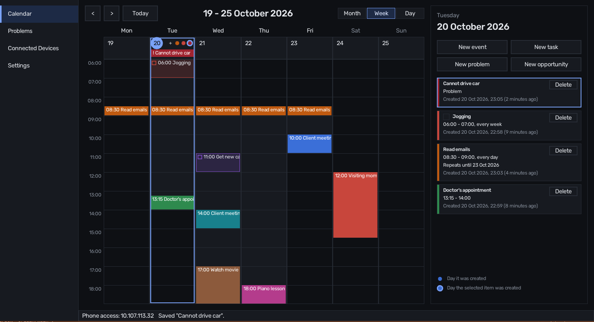

# Zeman



## Introduction

**Zeman** (Hebrew for "period" (of time)) is a practical offline calendar and task manager for Windows and Android. Instead of syncing your events, tasks and problems to a cloud service, it keeps them on your own Windows computer and serves them to your desktop and Android devices over the local network.

## Features

- Add events, opportunities, problems, tasks to your calendar.
- Link tasks to problems they solve, and see which problems are solved or still need work.
- View calendar items by month, week or day.
- Create repeating events and tasks.
- See added problems and their flow.

## Project contents

This repository contains the source code for both the desktop and Android apps, which are written in C using Raylib and RayGUI. User data is stored in SQLite database.

### Structure

- `desktop/` The desktop app (Windows).
- `android/` The Android app. It shows and edits the desktop app's calendar over the network; it keeps no data of its own.
- `shared/` Code both apps compile: the user interface, dates, events, and the network protocol and client.
- `assets/` Contains App icons.

Each of `desktop/`, `android/` and `shared/` has `src/` for its .c files and `include/zeman/` for its headers, which every file includes as `<zeman/app.h>`, `<zeman/server.h>` and so on, so that project headers are told apart from raylib's and the system's. The desktop build (`desktop/CMakeLists.txt`) and the Android build (`android/build.ps1`) each put their own `include` and `shared/include` on the compiler's include path; a new header goes in one of those folders.

### Dependencies and their management

`cmake/dependencies.cmake` downloads
- raylib 5.5,
- raygui 4.0,
- SQLite 3.51.0,
- the [Rubik](https://fonts.google.com/specimen/Rubik) font (with its SIL Open Font License), 
- Nayuki's [QR code generator](https://github.com/nayuki/QR-Code-generator) 1.8.0 and the
- [quirc](https://github.com/dlbeer/quirc) 1.2 QR decoder into `external/`, once; after that both builds are offline.

## Desktop app

### Prerequisites

- C compiler (tested with MinGW-w64 GCC 16)
- CMake 3.21 or newer (tested on version 4.4)

### Building

```sh
cd desktop
cmake --preset mingw-release
cmake --build --preset mingw-release
```

The executable is written to `desktop/build/release-win32/zeman.exe`, with the fonts it needs in `desktop/build/release-win32/fonts`. This Release build has optimizations on (CMake's default Release flags, `-O3` with MinGW) but keeps assertions compiled in, as TIGER_STYLE asks; it opens no console window. Use the `mingw-debug` preset for a debug build in `desktop/build/debug-win32/`, built unoptimized and with a console window attached, so that `printf`/`TraceLog` output and asserts are easy to see while developing. Both of these keep the database (`zeman.db`) at the repository root (see Usage below), so `desktop/build/` can be deleted at any time without losing events. Without presets, pass the generator explicitly, otherwise CMake on Windows falls back to NMake:

```sh
cmake -S desktop -B desktop/build/release-win32 -G "MinGW Makefiles" -DCMAKE_BUILD_TYPE=Release
cmake --build desktop/build/release-win32
```

#### Building a release folder to distribute

```sh
cd desktop
cmake --preset mingw-package
cmake --build --preset mingw-package
cmake --install build/package-win32
```

This writes `desktop/release/zeman.exe` and `desktop/release/fonts/`. Unlike the `mingw-release` preset above, this one turns on `ZEMAN_DATABASE_NEXT_TO_EXECUTABLE`, so `zeman.exe` creates and keeps `zeman.db` next to itself instead of at the repository root. That is what makes `desktop/release/` self-contained: copy the whole folder to any other Windows 10 or 11 computer (by USB drive, zip file, or network share) and double-click `zeman.exe` there — no installer, no separate runtime to install, and no repository needed on that computer. The executable is statically linked against raylib, raygui and SQLite, and its only external dependencies are Windows system DLLs and the Universal CRT, which both Windows 10 and 11 already ship; nothing else needs to be copied alongside it, and `desktop/release/` can be zipped up as-is. Rebuilding the release folder (for a new version) overwrites `zeman.exe` but leaves an existing `zeman.db` there untouched, since `cmake --install` only ever adds the files listed in `desktop/CMakeLists.txt`'s `install()` rules.

`zeman.exe --port PORT` serves phones on another port than 47800, for example when something else uses it; the QR code and the address shown carry the port. `zeman.exe --connect ADDRESS[:PORT]` runs the desktop app as a client of another desktop app, exactly as the phone does; it is a way to try the network side on one computer.

The navigation on the left switches between **Calendar**, **Problems** and **Connected Devices**. Problems shows every problem in four columns, from the least to the most complete: No planned tasks, Planned, Partly completed and Completed, each with how many problems it holds. Connected Devices shows the QR code that phones scan to connect, the address to type instead, and the phones connected now.

## Android app

### Building

From the `android` folder, on Windows:

```bat
build.bat
```

The first run downloads a JDK, the Android SDK and the NDK into `android/tools` (about 1.5 GB) and asks you to accept the Android SDK licenses (`build.bat -AcceptLicenses` accepts them without asking). Nothing is installed system-wide; CMake, which the desktop build needs anyway, is the only outside tool. Later builds take seconds.

The result is `android/build/zeman.apk`, for 64-bit ARM phones running Android 7.0 or newer. Copy it to the phone and open it there; Android asks to allow installing apps from that source. The APK is signed with a key made on the first build and kept in `android/keystore/` (not committed); keep it, because Android installs an update only when it is signed with the same key.

### Connecting

The phone and the desktop talk directly, within the same local network; nothing goes through the internet.

1. Start the desktop app and open **Connected Devices** in its navigation. The first time, Windows asks whether to allow it through the firewall: allow it on private networks.
2. Open the app on the phone, on the same Wi-Fi network, and press **Scan QR code** (recommended). Allow the camera when Android asks, and point it at the code on the desktop's screen.

Instead of scanning, type the address shown under the code (also in the desktop's status bar) into the phone. When the phone finds a desktop app on the network by itself, it also offers it with a **Use it** button.

The phone remembers the desktop and connects to it at the next start; to change or reconnect to it, open the navigation from the left edge of the screen (tap the arrow on the edge, or drag it out) and choose **Connection settings**, which offer the QR code, a desktop found on the network and the typed address. Changes made on either side appear on the other within about a second.

The desktop app accepts connections only from local network addresses (10.x.x.x, 172.16-31.x.x, 192.168.x.x and 169.254.x.x) and has no password, so anyone on the same local network can use it while it runs.

On the phone, swipe sideways over the calendar to move to the previous or next month, week or day; Back closes the form. Typing on the phone supports letters, digits and common punctuation, not letters such as a-umlaut.

## Usage

Click or tap an item in the calendar, a bar in a day or a block on the hours, to select it: its day opens in the panel, which scrolls to its card and rings it. On the desktop the pointer turns into a hand over items you can click.

In the week and day views on the desktop, an item on the hours can be changed by dragging: its top or bottom edge (the pointer turns into an up-and-down arrow there) changes its start or end time, and anywhere else on it moves the whole item to another time, or in the week view to another day, keeping its length. The changes snap to quarter hours, or to five minutes with Ctrl held; a preview shows the new times while dragging, and the release saves them. A repeating item changes as a whole, as when editing it. Escape cancels a drag. Dragging is off while a form is open, so that the form cannot save old times back over it. Select a day to see its events and tasks in the panel on the right, and use **New event** or **New task** to add one. When a day has more items than fit, scroll the panel with the mouse wheel, or drag it with a finger or the mouse; the bar at its right shows where you are. A task works like an event (dates, optional times, repeats, editing and deleting) and can also be checked off: tick its checkbox on its card. For a repeating task, each occurrence is checked off separately. In the calendar, tasks are outlined bars with a checkbox; done tasks are faded and struck through. The Event/Task toggle in the form switches an item between the two. Start and end dates are `YYYY-MM-DD`; times are `HH:MM` and optional (leave both empty for an all-day event).

An event can repeat every week, every X days, every month or every year. Monthly and yearly events keep the same date, so an event on the 31st skips months without one, and an event on 29 February appears only in leap years. Each repetition must end before the next one starts. A repeating event can have an optional **Repeat until** date: it is inclusive, so an occurrence that starts on that date still happens, in full, and none start after it. Leave it empty to repeat forever.

An event or task can have a location: fill in its address, its city, or both. Locations are shared, so every item saved with the same address and city links to the same location, and the card shows it below the dates.

Events and tasks also have an optional one-line description (up to 199 characters). Cards show it under the dates and location, wrapped over up to three lines.

Use **New problem** to record a problem: something that went wrong, with a name and an optional description. A problem is always recorded on the day it is created, whichever day is selected, and keeps that day when edited; it has no times, location or repeat. Problems show in dark red, marked with "!", and an event or task cannot be turned into a problem or back.

Tasks can solve problems. A task's form lists every problem below its fields, under **Problems this task solves**, with how many are checked; check the ones that completing the task solves, and save. The list scrolls when it does not fit. Opening a problem then lists its tasks and its status: **No planned tasks**, **Planned** (tasks linked, none done), **Partly completed** or **Completed**. A task counts as completed once any of its occurrences is checked off. A completed problem turns green, with a check mark, in the calendar and in the day's list.

To edit an event, click its card: the form opens with its details, and **Save** updates it. A repeating event is edited as a whole, so the form shows the dates of its first occurrence. Editing keeps the original creation time.

To delete an event, press **Delete** on its card and confirm; deleting a repeating event removes all of its repeats. Escape cancels the confirmation.

Each event records when it was created:

- A colored dot in a day cell marks the day an event was created.
- The dot of the selected event or task is ringed, and its card shows when it was created and how long ago, such as `Created 18 Oct 2026, 20:47 (yesterday)`: minutes and hours for the first hours, then "today", "yesterday", days, "last week", weeks, "last month", months, "last year" and years.

The month view numbers each week in a narrow column on the left, and the week view's title ends with the week's number, as in "19 - 25 October 2026, week 43". Weeks start on Monday and are numbered as ISO 8601 does, where week 1 is the week with the year's first Thursday, so the last days of December can be in week 1 and the first days of January in week 52 or 53.

The **Month**, **Week** and **Day** buttons at the top choose how many days the calendar shows (on a phone, in a row under the header). The arrow buttons, Page Up/Page Down, the mouse wheel over the calendar and sideways swipes on a phone move by that range.

In the week and day views, a white line across today's hours marks the time now and moves on every minute; other days have none.

In the week and day views on the desktop, drag over a day's hours to draw a block. Before you press, a short line under the pointer shows where the block will start, with its time. The block snaps to quarter hours, and on release the form for a new event opens with that day and the block's start and end times (switch it to **Task** in the form if it is one). Until you save, the new item shows on the timeline as a see-through ghost block, labelled "New event" until it has a title; it follows the times, date and repeat you type in the form, and disappears if you cancel. Hold Ctrl before pressing to draw in five-minute steps instead: as soon as Ctrl is down, a round magnifier follows the pointer, with the start line in it, showing every five minutes and the time the edge will get, and the block moves at a quarter of the pointer's speed so that each step is easy to hit. A block that reaches midnight ends at 23:59. Escape cancels a block while drawing. The mouse wheel scrolls the hours; on a phone, dragging still scrolls them.

Keys: arrows move by a day or a week, Page Up/Page Down move to the previous or next month, week or day, M, W and D switch between month, week and day, Home jumps to today, Tab moves between form fields, and Escape cancels the form. In a form field being typed into, Ctrl+V pastes at the cursor (line breaks become spaces), and Ctrl+C and Ctrl+X copy or cut the whole field, because the text boxes have no selection.

Events are stored in `zeman.db`, an SQLite database in the repository root (`zeman.db`, next to this README), whichever build directory the executable is in. CMake gives the executable that absolute path, so deleting a build directory does not delete the events; moving the repository means building again. The file is not committed, so back it up like any other file you want to keep. Databases from earlier versions are upgraded automatically when opened. A `desktop/release/` build (see "Building a release folder to distribute" above) is the exception: there, `zeman.db` sits next to `zeman.exe` instead, so the whole folder can be copied elsewhere as one self-contained unit.
