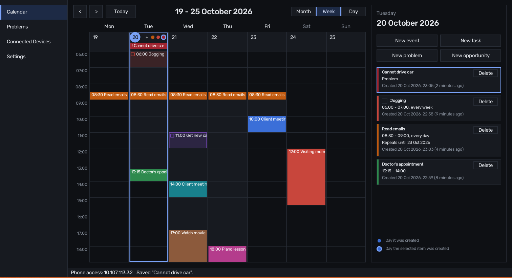

# Zeman



## Contents

- [Introduction](#introduction)
- [Features](#features)
- [Getting started](#getting-started)
  - [Supported systems](#supported-systems)
  - [Desktop app (Windows)](#desktop-app-windows)
  - [Android app](#android-app)
- [Documentation](#documentation)

## Introduction

**Zeman** (Hebrew for "period" (of time)) is a practical offline calendar and task manager for Windows and Android. Instead of syncing your events, tasks and problems to a cloud service, it keeps them on your own Windows computer and serves them to your desktop and Android devices over the local network.

## Features

- **Calendar:** add events, opportunities, problems and tasks, and view them by month, week or day, with ISO 8601 week numbers.
- **Repeating items:** events and tasks repeat every week, every X days, every month or every year, optionally until a date.
- **Tasks:** check tasks off (each occurrence of a repeating task separately), give them a deadline, and see them in four columns: Overdue, Today, Upcoming and Completed.
- **Problems:** link tasks to the problems they solve, and see which problems are solved or still need work, in four columns from No planned tasks to Completed.
- **Fast time editing:** draw a new event on the hours, or drag an item's edges or body to change its time; a five-minute zoom makes small steps easy.
- **Locations and descriptions:** events and tasks can have a shared location and a short description.
- **Android companion:** the phone shows and edits the desktop's calendar, and changes appear on both within about a second. Connect by scanning a QR code, by picking the desktop the phone finds on the network, or by typing its address.
- **Private by design:** your data lives in one SQLite file on your computer, and devices talk directly over your local network; nothing goes through the internet or a cloud service.
- **Portable:** build a self-contained release folder that runs on any Windows 10 or 11 computer, with no installer.

## Getting started

### Supported systems

| | Building | Running |
| --- | --- | --- |
| Desktop app | Windows 10 or 11 | Windows 10 or 11 |
| Android app | Windows 10 or 11 | 64-bit ARM phones with Android 7.0 or newer |

Both builds are written for Windows: the desktop build uses MinGW-w64 and CMake, and the Android build is a PowerShell script that uses the Windows build of the Android NDK. Building on Linux or macOS is not supported, and the desktop app does not run there. The Android app only needs a Windows computer to build it; the phone runs the finished APK.

Both builds start with the same one-time step, which they run themselves: CMake downloads raylib, raygui, SQLite, the font and the QR code libraries into `external/`. After that they work offline. See [Dependencies](docs/architecture.md#dependencies-and-their-management) for the list.

### Desktop app (Windows)

**Prerequisites**

- A C compiler: MinGW-w64 GCC (tested with GCC 16), on your `PATH`.
- CMake 3.21 or newer (tested with 4.4), on your `PATH`.

**Build and run**

The quickest way, from the repository root in PowerShell:

```powershell
.\run.ps1
```

It configures and builds the Release preset, and starts the app. Or do the steps yourself, in any shell:

```sh
cd desktop
cmake --preset mingw-release
cmake --build --preset mingw-release
build\release-win32\zeman.exe
```

The executable is `desktop/build/release-win32/zeman.exe`, with the fonts it needs next to it in `fonts/`. The Release build has optimizations on but keeps assertions compiled in, and opens no console window. The first start creates the database, `zeman.db`, in the repository root; `desktop/build/` can be deleted at any time without losing your data.

For development, use the `mingw-debug` preset instead (`cmake --preset mingw-debug`, `cmake --build --preset mingw-debug`). It builds unoptimized, in `desktop/build/debug-win32/`, with a console window attached, so that `printf` and `TraceLog` output and failed assertions are easy to see.

Without presets, pass the generator explicitly, because CMake on Windows otherwise falls back to NMake:

```sh
cmake -S desktop -B desktop/build/release-win32 -G "MinGW Makefiles" -DCMAKE_BUILD_TYPE=Release
cmake --build desktop/build/release-win32
```

**Build a release folder to distribute**

```sh
cd desktop
cmake --preset mingw-package
cmake --build --preset mingw-package
cmake --install build/package-win32
```

This writes `desktop/release/zeman.exe` and `desktop/release/fonts/`. Here `zeman.db` is created next to `zeman.exe` instead of in the repository root, so the folder is self-contained: copy it to any other Windows 10 or 11 computer (USB drive, zip file, network share) and double-click `zeman.exe`. There is no installer, no runtime to install and no repository needed there. Rebuilding the folder for a new version overwrites `zeman.exe` but leaves an existing `zeman.db` untouched.

**Options**

- `zeman.exe --port PORT` serves phones on another port than 47800.
- `zeman.exe --connect ADDRESS[:PORT]` runs the desktop app as a client of another desktop app, the way the phone does.

The first time the app serves the network, Windows asks whether to allow it through the firewall: allow it on private networks, or phones cannot connect.

### Android app

The Android app is built on Windows, then installed on the phone.

**Prerequisites**

- Windows 10 or 11 with PowerShell, which comes with Windows.
- CMake 3.21 or newer on your `PATH` (the same as for the desktop app). It is the only tool you install yourself.
- About 1.5 GB of free disk space and an internet connection for the first build. A JDK, the Android SDK and the NDK are downloaded into `android/tools/`, and nothing is installed system-wide.

**Build**

From the `android` folder, in Command Prompt or PowerShell:

```bat
build.bat
```

The first run asks you to accept the Android SDK licenses; `build.bat -AcceptLicenses` accepts them without asking. Later builds take seconds. The result is `android/build/zeman.apk`.

The APK is signed with a key that the first build makes and keeps in `android/keystore/` (not committed). Keep that key: Android installs an update only over an app signed with the same key.

**Install on the phone**

1. Copy `zeman.apk` to the phone (USB cable, cloud drive, or any file transfer you use).
2. Open the file on the phone. Android asks to allow installing apps from that source (for example from your file manager or browser); allow it.
3. Open **Zeman**. Allow the camera when asked, which is only needed to scan the desktop's QR code.

**Connect to the desktop**

1. Start the desktop app, open **Connected Devices** in its navigation, and keep the phone on the same Wi-Fi network.
2. In the phone app, press **Scan QR code** and point the camera at the code on the desktop's screen. Or type the address shown under the code.

See [Connecting a phone](docs/instruction-manual.md#connecting-a-phone) in the manual for more.

## Documentation

- [Instruction manual](docs/instruction-manual.md): how to use Zeman, on the desktop and on the phone.
- [Architecture](docs/architecture.md): the directory structure, the dependencies, how the data is stored, and the Code Digger development tool.
- [Programming mindset](docs/programming-mindset.md) and [C programming style guide](docs/c-programming-style-guide.md): how the project is developed.
